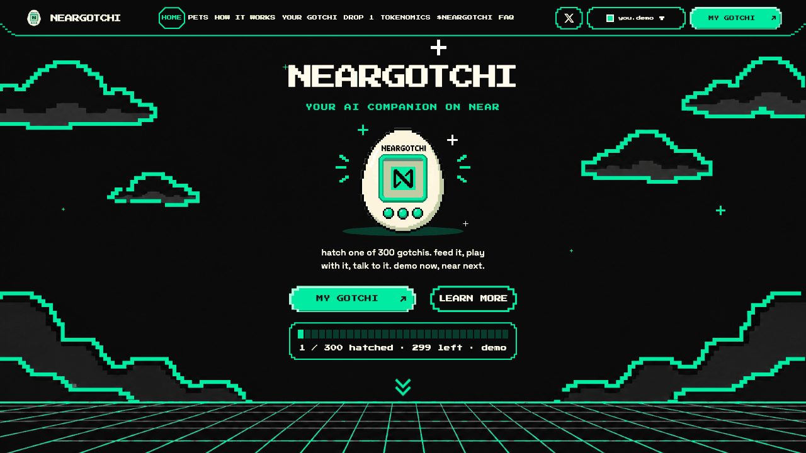
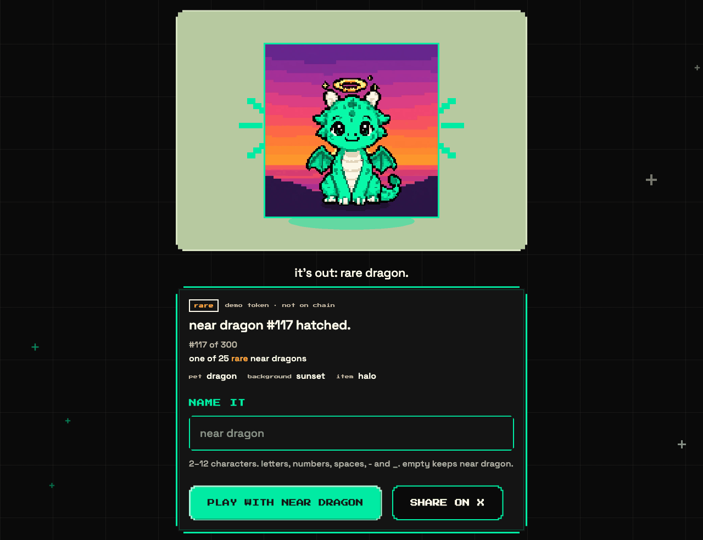
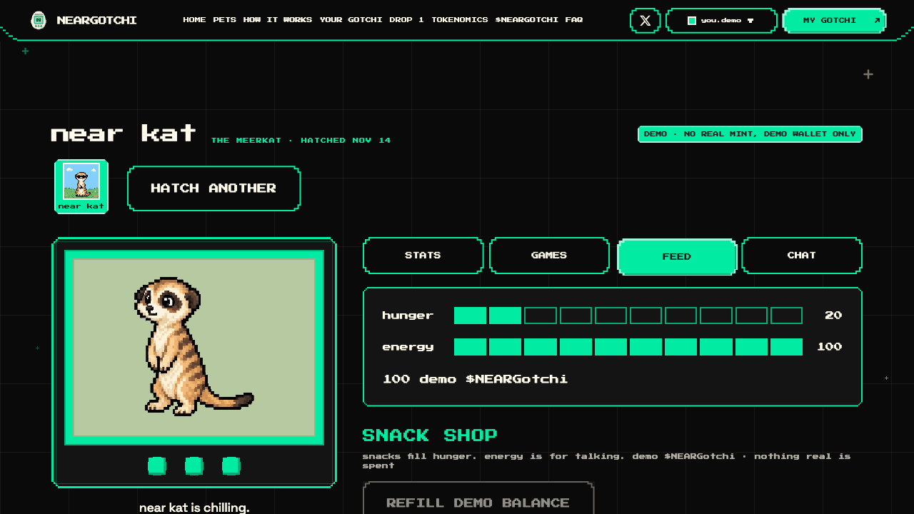
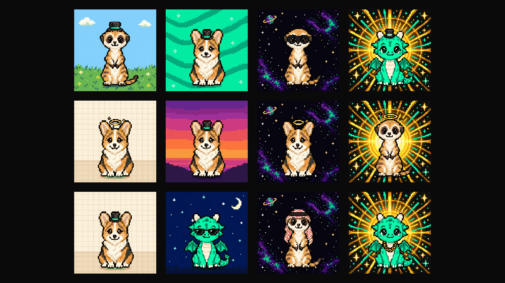
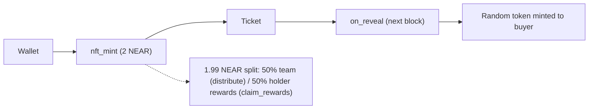

# NEARGOTCHI

An AI pet on NEAR. Hatch one of 300 pixel gotchis for 2 NEAR, feed it, play with it, chat with it. The pet is an NFT: owning the token is what lets you open that pet, its chat and its rewards.

Built for the NEAR HACKATHON (tracks: games, nfts). Unofficial fan project, not affiliated with or endorsed by NEAR.

| Links | |
|---|---|
| Live site (mainnet, real NEAR) | https://neargotchi.com |
| Demo (testnet, no real money) | https://neargochi-demo.vercel.app |
| Drop 1 contract (mainnet) | [`drop1.neargochi-dev.near`](https://nearblocks.io/address/drop1.neargochi-dev.near) |
| GitHub tag | `hackathon-submission` |

<table>
  <tr>
    <td align="center"><br><sub>home</sub></td>
    <td align="center"><br><sub>hatch</sub></td>
  </tr>
  <tr>
    <td align="center"><br><sub>feed &amp; chat</sub></td>
    <td align="center"><br><sub>300 pets</sub></td>
  </tr>
</table>

### How a hatch works



## Try it in 2 minutes (no wallet, no real money)

```
npm ci && NEXT_PUBLIC_CHAIN=demo npm run dev
```

Open http://localhost:3000/mint, click **hatch**, then go to /pet. More ways to try it: [Quick start for judges](#quick-start-for-judges-no-real-money).

**Warning:** mainnet means real NEAR, and the contract is not audited. Only spend what you can afford to lose.

## Hatch proceeds: 50% team / 50% holder rewards

Every hatch pays 2 NEAR. 0.01 NEAR stays in the contract for the token's storage; the other 1.99 NEAR is split:

- **50% team** (0.995 NEAR): accrues in the contract and is paid to the team account by `distribute()` (anyone may call it).
- **50% holder rewards** (0.995 NEAR): split **equally between the tokens hatched before this payment**. The new token
  doesn't share in its own payment or in earlier ones (each token keeps a checkpoint of the reward counter from the moment it
  was minted). Owners claim with `claim_rewards(token_ids)` (on the site: /pet → stats → claim); `pending_rewards(token_id)` shows
  what a token has waiting. Rewards belong to the token: if you transfer or sell it unclaimed, the new owner claims them.
- **First hatch:** no earlier token exists, so its holder half goes to the team. **Rounding:** the share is divided in yoctoNEAR;
  the remainder (fewer than 300 yoctoNEAR per hatch) goes to the team.
- These two are the only payouts of hatch proceeds in the contract. Nothing is promised about any value: holder rewards exist
  only if later hatches happen.

Example: hatch #2 pays 0.995 NEAR to token #1; hatch #3 pays 0.4975 NEAR to each of tokens #1 and #2.

## Roadmap (ideas, not promises)

- Pet battles: friendly duels using a pet's stats and tier.
- Pet arena: a place where pets meet and compete.

No dates, and none of this is part of the current drop. The drop is 300 tokens, fixed in the contract.

## Quick start for judges (no real money)

Everything below uses the offline demo mode or **testnet** (free test NEAR from a faucet, no value). Nothing here touches mainnet.

**Variant 1: no wallet, offline demo (fastest).** One command, no chain, no wallet, no account:
`npm ci && NEXT_PUBLIC_CHAIN=demo npm run dev`, then open http://localhost:3000/mint and click **hatch**: the egg cracks and shows a random pet;
then open /pet to feed it, play and chat (scripted answers). Everything is a localStorage mock in your browser.
Checks: `npm run check:drop1` (game logic), `npm run check:chat` (chat route, mocked), `cd contracts/drop1 && cargo test --lib` (contract).

**Variant 2: testnet with a wallet.** You need a NEAR **testnet** wallet (MyNearWallet or Meteor) with about 2.5 test NEAR.

**A. Hosted demo build (testnet):** open https://neargochi-demo.vercel.app/mint.
**B. Locally, 3 steps:**
1. `npm install && cp .env.example .env.local`
2. in `.env.local` set `NEXT_PUBLIC_CHAIN=testnet`, `NEXT_PUBLIC_DROP1_CONTRACT=neargotchi-drop1-ng67.testnet`,
   `NEXT_PUBLIC_TREASURY=neargotchi-team-ng67.testnet` (optional: `NEAR_AI_API_KEY=<key>` for real chat answers; without it the chat is scripted)
3. `npm run dev` and open http://localhost:3000/mint

Then (same steps on A and B; expected result after each):
1. /mint shows the live counter "x / 300 hatched" read from the contract.
2. **connect wallet** and sign in: the header shows your account id.
3. **hatch** (2 test NEAR + gas), approve in the wallet: the egg cracks and shows the pet the contract drew, with its tier; the counter goes up by one.
4. /pet, feed tab, **buy & feed** a snack (small test NEAR payment): hunger drops.
5. /pet, chat tab: the pet answers ("powered by near ai"); each answered message costs 4 energy; the energy pack in the feed tab refills it.

| | On-chain (NEAR mainnet / testnet) | Off-chain (your browser) |
|---|---|---|
| Pet NFT, ownership, random draw | yes (drop 1 contract) | |
| Hatch payment (2 NEAR), 50% team / 50% holder rewards, 5% royalty | yes | |
| Holder rewards (pending, claim) | yes (`pending_rewards`, `claim_rewards`) | |
| Snack and energy-pack payments | yes (plain NEAR transfer to the team account) | the effect (hunger, energy, stock) |
| Hunger, energy, stats, chat history | | yes |
| Mini-games (catch the snack, fetch, hide & seek) | | yes |
| Chat answers | | NEAR AI Cloud API (Claude Haiku 5.5, GLM fallback) via a server route |

## Contracts and transactions

- Drop 1 is live on NEAR mainnet (real NEAR). Drop 1 NFT contract (mainnet): [`drop1.neargochi-dev.near`](https://nearblocks.io/address/drop1.neargochi-dev.near) (owner `neargochi-dev.near`, team `neargotchiai.near`; test mint, token #195: [`9JEEHWBk…`](https://nearblocks.io/txns/9JEEHWBkgMtmcSYk15jUkyCAG8bTovZuzF2Rz2TduBcZ); deploy record in `docs/MAINNET-RUNBOOK.md`). Minting on mainnet can be paused by the owner (`drop_status` shows `paused`).
- $NEARGotchi token (mainnet): [`neargotchi.nearlytrade.near`](https://nearblocks.io/address/neargotchi.nearlytrade.near)
- Drop 1 NFT contract (testnet, current contract with holder rewards): [`neargotchi-drop1-ng67.testnet`](https://testnet.nearblocks.io/address/neargotchi-drop1-ng67.testnet)
- Older testnet contract (no holder rewards): [`neargotchi-drop1-ng57.testnet`](https://testnet.nearblocks.io/address/neargotchi-drop1-ng57.testnet)
- Holder rewards on testnet ng67: mint by a second account [`7edZwRA1…`](https://testnet.nearblocks.io/txns/7edZwRA1d5dSCQ6KFJNhFuLowScrzLgjPkaS8VfR16iF) → token #198's owner claims 0.995 NEAR [`4T7Ck242…`](https://testnet.nearblocks.io/txns/4T7Ck242PEM3rczLrY94fghnprTwNDegVgeiax7hNBDj)
- Test mint (admin account, token #83): [`9YizpnEU8jo5NY1tnhiozrTeTnTMQtvTteAmNm2ugtMB`](https://testnet.nearblocks.io/txns/9YizpnEU8jo5NY1tnhiozrTeTnTMQtvTteAmNm2ugtMB)
- Mint from the website (token #10): [`D5NRFD7v9pwDmw2Kmg21QtAgf3CRrZ5R1hehEiYnBnf7`](https://testnet.nearblocks.io/txns/D5NRFD7v9pwDmw2Kmg21QtAgf3CRrZ5R1hehEiYnBnf7)

## How it works

- **Contract** (`contracts/drop1`, Rust, near-sdk 5): NEP-171/177/178/181/297 + 5% royalty. `nft_mint` takes 2 NEAR and issues a ticket; a
  self-callback in a later block draws a random token from the pool of 300 (public `reveal(ticket)` is the fallback). Proceeds:
  50% team (`distribute()`), 50% holder rewards (reward per token, `claim_rewards`), see above. Mainnet limit: 5 mints per account.
  40 unit tests + a near-workspaces sandbox suite (300 mints, sold out, fallback, rewards, claims, transfer, limit) run in GitHub
  Actions. Gas gate against selecting the draw by attached gas: `nft_mint` needs at least 35 Tgas, a
  reveal at least 18 Tgas, checked before the draw. The deployed mainnet wasm has sha256 `a3412e7aa1e1f6df63beb0dd32ce7e2241d6543fcd51cfd7cf1603512d8b003a` (base58 `BzH6tuQv4EDojTH2Fw2utZQKzP7HCGnma1FVL3vanhwf`, upgrade tx `EdZ7iKo2DPPy6psJLh6n3sD3H5iS7zisWmuEAXBtzbvA`, 2026-11-13); the code on chain is the code in this repo as of that deployed version (rebuild with `contracts/drop1/build.sh` and compare the sha256). The contract has no upgrade method, but its account still holds a full-access key (used for the 2026-11-13 gas-gate update), so whoever holds that key can still replace the code. Deleting that key is a separate, irreversible step that has not been done. Details: `docs/MAINNET-RUNBOOK.md`,
  `docs/CONTRACT-SETUP.md`, money-path review in `docs/REPORT.md` (DONE: 067).
- **Mainnet mode:** `NEXT_PUBLIC_CHAIN=mainnet` + `NEXT_PUBLIC_DROP1_CONTRACT` + `NEXT_PUBLIC_TREASURY` (no defaults). The mint page
  shows the real-NEAR price on the hatch button and under it; no extra confirmation besides the wallet.
- **RPC:** all chain reads (counter, owned tokens, rewards, tx status after a wallet redirect) go through a fallback list of
  free public endpoints without API keys (FastNear, dRPC, ZAN, Intear; `rpc.*.near.org` is deprecated and answers 429): each
  request tries the endpoints in turn (starting with the last one that worked), then backs off and repeats; the counter keeps
  the last value it read. `NEXT_PUBLIC_RPC_URL` (comma-separated) is tried first. No proxy and no key are needed.
- **Energy on mainnet = NEAR AI credits, kept on the server** (Upstash Redis ledger per token, NEP-413 wallet sign-in, chat cost
  and energy-pack payments verified server-side; demo / testnet unchanged): `docs/ENERGY.md`.
- **Game state on chain builds** is stored per chain + contract + account + token: /pet shows only pets whose token the
  connected account holds on the current contract (`nft_tokens_for_owner`); state from another contract or account stays in the
  browser under its own key but is never shown.
- **Front** (Next.js, React, Tailwind): `lib/chain.ts` (config + RPC), `lib/near.ts` (wallet-selector), `lib/wallet.ts`, `lib/drop1.ts`.
  Redirect wallets come back to `/mint?transactionHashes=…` and the mint finishes from the transaction result.
- **Images:** on mainnet `base_uri` is the project's dedicated Pinata IPFS gateway
  (`https://lavender-known-gorilla-623.mypinata.cloud/ipfs/<CID>/`) for a folder with the 300 original PNGs, and every `media_hash`
  matches (`scripts/ipfs_drop1.py` checks it). Public gateways are not used: ipfs.io / dweb.link stopped serving hotlinks on
  2026-09-21 and the public Pinata gateway rate-limits; `base_uri` stays changeable until a second pin provider is added
  (`docs/NFT-IMAGES.md`). The testnet contracts use `https://neargochi.vercel.app/drop1-full/`, which serves 512px WebP
  renders (there the `media_hash` does not match the served bytes).

## NEAR AI

Chat via the [NEAR AI Cloud](https://docs.near.ai/cloud/guides/openai-compatibility) API (OpenAI-compatible; Claude Haiku 5.5, GLM as fallback), called from a server route, `app/api/chat/route.ts`. Haiku is an external provider behind NEAR AI Cloud.
The key never reaches the browser.

1. Create a NEAR AI Cloud API key.
2. Locally: put `NEAR_AI_API_KEY=<your key>` in `.env.local` (gitignored). On Vercel: Project Settings → Environment Variables → `NEAR_AI_API_KEY`, then redeploy.
   Optional: `NEAR_AI_MODEL` (default `anthropic/claude-haiku-5-5`; if it fails, one retry on `z-ai/glm-5.3-flash`).
3. Open `/pet` → chat tab. The note under the title says "powered by near ai". Each answered message costs 4 energy; a failed AI call costs nothing.

Without the key the chat falls back to scripted answers and says "demo mode (mock answers)". Limits: 300 chars per message, 8 messages of history,
150 output tokens, 9 s timeout per model attempt, 12 requests per minute per IP. Tests: `npm run check:chat` (mocked fetch).

## What is a mock

- Pet state (hunger, energy, stats), shop stock and the mini-games live in your browser. The demo balance in $NEARGotchi exists only in demo mode.
- Chat: real answers through the NEAR AI Cloud API when `NEAR_AI_API_KEY` is set (see above), scripted answers otherwise.
- Nothing about the game state is on-chain; only ownership of the NFT is.

## Honest notes

- No audit. The money paths were reviewed by us (findings and what was not checked: `docs/REPORT.md`, DONE: 067), which is not an audit.
  Mainnet means real NEAR; only spend what you can afford to lose.
- On NEAR, the random seed comes from block producers, so on-chain randomness is not perfect.

## Hackathon window, AI assistance, libraries

- **Window:** all code in this repository was written during the hackathon window (first commit 2026-11-05); there is no pre-hackathon baseline.
  Full commit list: https://github.com/neargotchi/NearGotchi/commits/main. A tag `hackathon-submission` points at the submitted commit.
- **AI assistance:** the code (front end, server routes, contract, tests, docs) was written with Claude Code (Anthropic); commits carry a
  `Co-Authored-By: Claude` trailer. The in-game chat runs on NEAR AI Cloud (Claude Haiku 5.5, GLM fallback). Pet art: the base pet sheets,
  accessories and backgrounds are in `assets-raw/`; the 300 NFT images are composed from them by `scripts/compose_drop1.py`
  (Pillow + numpy, deterministic). Art disclosure: The source art (the base pet sheets and the layers composed from them) was produced with AI image generation through Higgsfield, mainly OpenAI GPT Image models; other models available in Higgsfield may also have been used. The 300 tokens themselves are composed deterministically by code (`scripts/compose_drop1.py`) from those sheets.
- **Libraries (all of them):** npm, from `package.json`: next, react, react-dom, tailwindcss, @tailwindcss/postcss,
  @near-wallet-selector/core, /modal-ui, /my-near-wallet, /meteor-wallet; dev: typescript, eslint, eslint-config-next, @types/node,
  @types/react, @types/react-dom. Check scripts also import `@near-js/crypto` and `@near-js/signers` (installed through the wallet
  selector). Rust, from `contracts/drop1/Cargo.toml`: near-sdk 5, near-contract-standards 5; tests: near-workspaces, tokio,
  serde_json, anyhow, reqwest. Python scripts (`scripts/requirements.txt`): Pillow, numpy. Fonts: Press Start 2P and Space Grotesk
  (SIL OFL, via `next/font/google`). No template or boilerplate beyond the default Next.js project config files (tsconfig, eslint,
  postcss) generated by the Next.js tooling. No third-party game or NFT code was copied in.

## Deploy

The site is deployed with the Vercel CLI from a local checkout (no Git integration): `npx vercel@latest login`, `npx vercel@latest link`
(existing project), then `scripts/deploy-vercel.sh` after each commit (deploys a clean `git archive` export of HEAD without
`.git`, then deletes it). `.vercelignore` keeps local env files and large local-only folders out of the upload; environment variables live in the Vercel project, and `NEXT_PUBLIC_*` changes need a
redeploy. Details and troubleshooting: `docs/DEPLOY.md`.

## Stack

Next.js 16, React 19, Tailwind 4, `@near-wallet-selector` 10, Rust + near-sdk 5, near-workspaces.

## License

MIT, see `LICENSE`.
